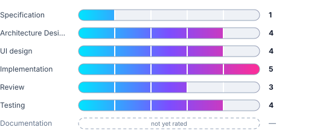

# Meander

[](https://sonarcloud.io/summary/new_code?id=Rrayor_meander)
[](https://sonarcloud.io/summary/new_code?id=Rrayor_meander)
[](https://sonarcloud.io/summary/new_code?id=Rrayor_meander)
[](https://sonarcloud.io/summary/new_code?id=Rrayor_meander)
[](https://sonarcloud.io/summary/new_code?id=Rrayor_meander)

[](https://sonarcloud.io/summary/new_code?id=Rrayor_meander)
[](https://sonarcloud.io/summary/new_code?id=Rrayor_meander)
[](https://sonarcloud.io/summary/new_code?id=Rrayor_meander)
[](https://sonarcloud.io/summary/new_code?id=Rrayor_meander)
[](https://sonarcloud.io/summary/new_code?id=Rrayor_meander)
[](https://sonarcloud.io/summary/new_code?id=Rrayor_meander)

Offline desktop weekly kanban planner. Tauri app: Rust backend, React (Vite) + TypeScript + Tailwind frontend, SQLite storage.

## AI usage transparency

_The Dim Software Factory_

<picture>
  <source srcset="docs/ai-usage/ai-usage-avg-dark.svg" media="(prefers-color-scheme: dark)">
  
</picture>

<picture>
  <source srcset="docs/ai-usage/ai-usage-dark.svg" media="(prefers-color-scheme: dark)">
  
</picture>

_0 = no AI at all · 5 = only vibes_

<details>
<summary>Per-stage explanations</summary>

- **Specification (1)** — AI has corrected mistakes and filled in gaps
- **Architecture Design (4)** — I skimmed through the AI design and made corrections in the few places where it seemed necessary
- **UI design (4)** — The AI had free hand with some directions
- **Implementation (5)** — Fully AI generated
- **Review (3)** — Both AI and human review was used, but not entirely thorough
- **Testing (4)** — The AI wrote the tests, I suggested adjustments and did manual testing

</details>

## Development setup

Prerequisites: Node.js, Rust toolchain, and Tauri system dependencies ([docs](https://v2.tauri.app/start/prerequisites/)).

```sh
npm install        # frontend deps
npm run dev        # Vite dev server (frontend only)
cargo tauri dev    # full desktop app with hot reload
```

## Testing

```sh
npm run test       # Vitest unit tests (frontend)
npm run test:e2e   # Playwright e2e (mocked Tauri IPC)
npm run test:smoke # WebdriverIO smoke test against the real binary
cargo test         # Rust unit + cucumber acceptance tests (in src-tauri/)
```

## Generated code

`src/api/bindings.ts` is generated from Rust types via [specta](https://github.com/specta-rs/specta) and committed to the repo — the frontend builds without Rust. When adding or changing a struct that crosses the IPC boundary:

1. Derive `specta::Type` on it and add it to `src-tauri/src/bindings.rs`
2. Run `cargo run --bin export-bindings` to regenerate `bindings.ts`
3. Commit both — `cargo test` asserts the committed file is fresh

## Docs

- `docs/specification.md` — feature specs and acceptance criteria (source of truth)
- `docs/architecture/overview.md` — stack and architectural decisions
- `docs/CONTRIBUTION.md` — required checklist before committing
- `docs/testing.md` — test layer conventions
